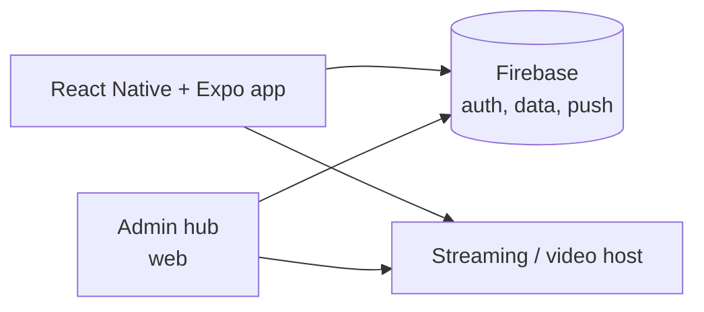

# Teleios Connect — Case Study

Mobile app for a church community: live streaming, sermon archives and community notices. Used by 200+ people weekly across 7 countries. Source is private; this repo documents the product and engineering decisions.

**My role:** sole engineer, design through release.

## Problem
Members outside Nairobi and abroad had no reliable way to watch services live or catch up later, and notices lived in scattered chats.

## Solution
- Live stream and on-demand sermon archive
- Community notices with push delivery
- Admin hub for staff to publish content without engineering help

## Architecture

## Decisions
| Decision | Why |
|---|---|
| React Native + Expo | One codebase for iOS and Android, fast OTA updates for a one-person team. |
| Firebase backend | Auth, realtime data and push with no servers to run for a volunteer-operated org. |
| Separate admin hub | Non-technical staff publish; the app stays read-focused and simple. |
| Designed for patchy connectivity | Many viewers are on mobile data in varying conditions. |

## Stack
React Native · Expo · Firebase · TypeScript

Portfolio: https://creative-operator.vercel.app/
