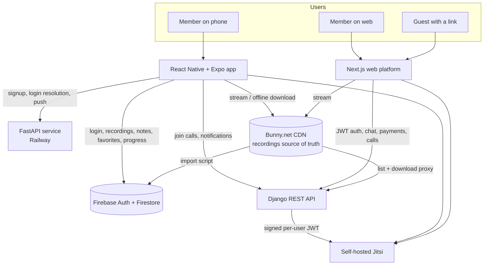

# Teleios Connect — Case Study

A church community platform with two member-facing surfaces, a **mobile app** and a **web platform**, that share accounts, notifications, call infrastructure and a single recordings library. 200+ people use it weekly across 7 countries. Source is private; this repo documents the product and the engineering decisions.

## My role
- **Mobile app and its backend (owner):** React Native + Expo app, Firebase layer, FastAPI service on Railway, Cloud Functions, and the Bunny.net import pipeline. Architecture through store release.
- **Web platform and Django API (contributor):** built with a collaborator, who is the primary author of the Django backend and Next.js frontend. I contributed to both and wired the mobile app into the same API (calls, auth, notifications).

## Problem
Members outside Nairobi and abroad had no reliable way to watch Sunday recordings, join calls or get notices, and each need lived in a different chat or link.

## How the pieces connect

**What this means for a member**
- One recordings library. Files live once on Bunny.net; the app reads them via Firestore metadata, the web platform via the Django API. A new Sunday recording appears in both.
- One call experience. Mobile and web both join the same self-hosted Jitsi rooms using JWTs issued by the Django API; hosts and co-hosts become moderators, and anyone with a shared link can join as a non-moderator guest from the web, no account needed.
- Same community, different strengths. Phone for watching, downloading for offline and quick notices; web for chat, tithes and offerings, files and calls.

## Mobile app
- Stream or download recordings (video and audio) from the CDN for offline playback; per-member notes, favorites and resume position.
- Member self-registration with approval, admin tools for staff, auto-logout when backgrounded.
- Join-only calls through the Django API.
- Shipped to Android and iOS with EAS.

## Web platform and Django API
- Role-based access (members, group facilitators, coordinators, leadership, elders) and an approval workflow for new members.
- Real-time chat rooms with media and read receipts; notifications by email, push and SMS.
- Tithes and offerings via M-Pesa STK Push, Stripe and PayPal with receipts and webhooks.
- Recordings page with authenticated, streamed downloads through a backend proxy (progress and cancel).

## Decisions
| Decision | Why |
|---|---|
| Bunny.net as the single source of truth for media | Cheap global delivery; every surface reads the same files and nothing is re-uploaded. |
| Firestore metadata over scanning the CDN | Fast listing, real-time updates, per-user notes/favorites/progress without extra servers. |
| Self-hosted Jitsi with per-user JWTs | Role-aware moderation, guest links, no per-minute vendor cost. |
| Mobile talks to Firebase and to Django | Firebase for the recordings experience; Django for roles, calls and notifications shared with web. |
| Offline-first downloads on mobile | Many members are on mobile data of varying quality. |

## Stack
React Native · Expo · TypeScript · Firebase (Auth, Firestore, Cloud Functions) · FastAPI · Django REST Framework · Next.js · Tailwind · Jitsi · Bunny.net · M-Pesa · Stripe · Docker · Railway

Portfolio: https://creative-operator.vercel.app/
